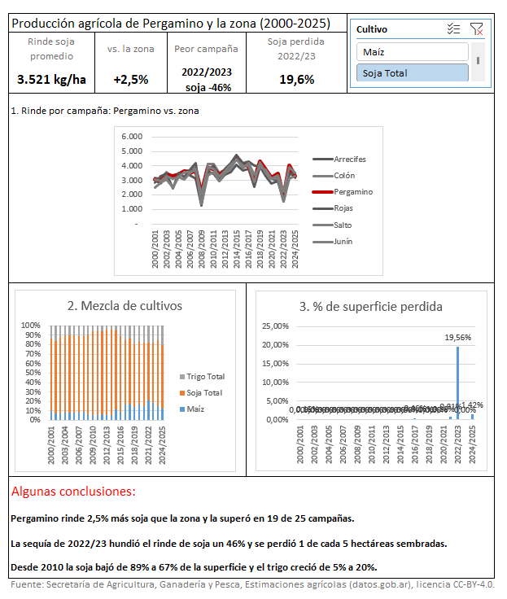

# Producción agrícola de Pergamino y la zona (2000-2025)

Análisis del rinde de soja y maíz en el partido de Pergamino (Buenos Aires) comparado con los partidos vecinos, a partir de datos oficiales de estimaciones agrícolas. Hecho en Excel con Power Query y tablas dinámicas.

## Preguntas

1. ¿Pergamino rinde más o menos soja que la zona? ¿Qué partido rinde más?
2. ¿Cómo evolucionó el rinde de soja y maíz en los últimos 25 años?
3. ¿Cuál fue la peor campaña y cuánto cayó?
4. ¿Cambió la proporción de hectáreas entre soja, maíz y trigo?
5. ¿En qué campañas se perdió parte de la soja sembrada?

## Datos

- **Fuente:** [Estimaciones agrícolas](https://www.datos.gob.ar/dataset/estimaciones-agricolas), Secretaría de Agricultura, Ganadería y Pesca (Dirección de Estimaciones Agrícolas), publicado en datos.gob.ar.
- **Licencia:** CC-BY-4.0.
- **Versión usada:** `estimaciones-agricolas-2026-03.csv` (~160.000 filas, todos los cultivos y partidos del país desde 1969/70).
- **Recorte para este análisis:** soja total, maíz y trigo total; provincia de Buenos Aires; partidos de Pergamino, Arrecifes, Colón, Junín, Rojas y Salto; campañas 2000/01 a 2024/25. Quedan 450 filas.
- **Unidades:** superficie en hectáreas, producción en toneladas, rinde en kg/ha.

## Proceso

1. **Conexión directa al CSV** desde Power Query (Obtener datos → Desde la web), sin descargar el archivo a mano. Si el dataset se actualiza, alcanza con apretar *Actualizar todo*.
2. **Filtros en Power Query** antes de cargar a la hoja, para no traer las 160.000 filas.
3. **Partidos con el mismo nombre.** Existen un Colón en Entre Ríos y otro en Córdoba, y un Junín en Mendoza. Filtrando solo por partido, los datos se mezclan entre provincias sin dar ningún error. Por eso se filtra primero por provincia.
4. **Soja total y no soja 1ra + 2da.** El dataset trae "soja total" y también sus partes; sumarlas contaría la soja dos veces.
5. **Limpieza:** se quitaron columnas de códigos, se ajustaron los tipos de dato y se renombraron las columnas.
6. **Rinde calculado como suma sobre suma.** Para el rinde de la zona o de un período no se promedian los rindes de cada partido: se usa un campo calculado `producción total × 1000 / superficie cosechada total`. Promediar rindes le daría el mismo peso a un partido chico que a uno grande.
7. **Análisis** con una tabla dinámica por pregunta y un tablero con KPIs, 3 gráficos y un segmentador por cultivo.

## Hallazgos

**1. Pergamino rinde 2,5% más soja que la zona.** Promedia 3.521 kg/ha contra 3.434 de la zona y es el segundo partido que más rinde, detrás de Colón (3.595 kg/ha). Arrecifes es el que menos rinde. Además es consistente: superó el promedio de la zona en 19 de las 25 campañas. En maíz, en cambio, Pergamino está prácticamente igual a la zona y el que más rinde es Rojas.

**2. El rinde casi no mejoró en 25 años.** En soja, el promedio de Pergamino pasó de 3.293 kg/ha (2000-2009) a 3.501 kg/ha (2015-2024), una mejora del 6%. En maíz pasó de 8.540 a 8.620 kg/ha, apenas +1%. Si se comparan solo los primeros y los últimos 5 años, la mejora desaparece, porque el último período incluye la sequía de 2022/23.

**3. La peor campaña fue 2022/23.** La soja rindió 1.857 kg/ha (−46% contra la campaña anterior y −47% contra el promedio) y el maíz 4.800 kg/ha (−36% y −44%). La causa principal fue la sequía, y la segunda, la helada tardía. La segunda peor fue 2008/09, también para los dos cultivos. Hubo años malos para un solo cultivo: 2011/12 para el maíz y 2001/02 para la soja.

**4. La zona dejó de depender tanto de la soja.** La soja es por lejos el cultivo con más hectáreas, pero pasó de 77% de la superficie en 2000/01 a un pico de 89% en 2010/11, y desde ahí bajó a 67% en 2024/25. El trigo fue el que más creció: de 5% en 2010/11 a 20% en 2024/25. El maíz pasó de 6% a 13% en el mismo período.

**5. En 2022/23 se perdió 1 de cada 5 hectáreas de soja.** Se sembraron 163.102 ha y se cosecharon 131.202: se perdieron unas 31.900 ha (19,6%). En un año normal la pérdida es de 0 a 1%.

## Limitaciones

- Son **estimaciones oficiales**, no datos censales.
- Mucha soja es "de segunda": se siembra en el mismo lote después de cosechar el trigo. Por eso la suma de hectáreas de los tres cultivos es mayor que la superficie física del partido, y los porcentajes de la mezcla son sobre hectáreas sembradas, no sobre tierra.
- La comparación es contra 5 partidos vecinos elegidos por cercanía, no contra toda la provincia.

## Archivos

| Archivo | Contenido |
|---|---|
| `agro_pergamino.xlsx` | Datos filtrados (Power Query), tablas dinámicas por pregunta, hallazgos y tablero |
| `tablero.png` | Captura del tablero |

## Herramientas

Excel · Power Query · Tablas dinámicas y campos calculados · Gráficos dinámicos y segmentadores

## Autor

Thomas Centurión · [LinkedIn](https://www.linkedin.com/in/thomascenturion/)
